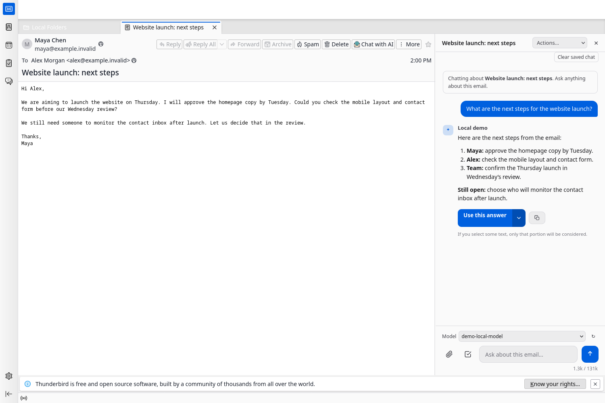
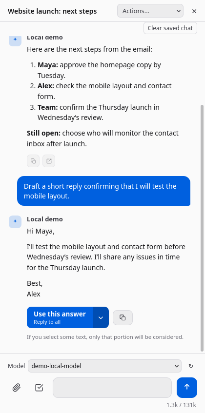

# ThunderAI Side Panel

Chat about an email conversation without leaving Thunderbird. Summarize the thread, draft a reply, attach documents and return to your saved conversation later.

An independent fork of [ThunderAI by Mic](https://github.com/micz/ThunderAI), maintained by [Pedro Madruga](https://github.com/pmadruga). Upstream history and attribution are preserved under GPL-3.0-or-later. This is not an official ThunderAI release.



*Actual Thunderbird interface with fictional email and a local mock provider. No personal mail is shown.*

## Features

- **Chat beside your email:** the sidebar follows the selected conversation.
- **Use your chosen provider:** OpenAI, Anthropic, Gemini, Ollama or an OpenAI-compatible API, with model selection in the chat.
- **Bring documents:** attach supported PDF, DOCX and text files as context.
- **Resume a conversation:** encrypted local history is separated by account, thread and provider endpoint.
- **Control retention:** clear one conversation or all history, with default limits of 90 days and 50 MiB.
- **Keep upstream actions:** proofreading, translation, summaries and other ThunderAI email tools remain available.

<details>
<summary>See a follow-up reply draft</summary>

<p></p>

The demo reopens the saved conversation before asking for this reply. Email and responses are synthetic.

</details>

## Install

Download an XPI when available from [this fork's releases](https://github.com/pmadruga/thunderai-sidebar/releases), or [build from source](#development). In Thunderbird, open **Add-ons and Themes**, select the gear menu, then **Install Add-on From File**. Choose the XPI; its `.sha256` sidecar lets you check the download.

Tested on **Thunderbird 156 on Fedora**. The manifest allows Thunderbird 140 or later, but other versions and platforms still need testing.

The fork has a separate add-on ID and storage. Disable original ThunderAI to avoid duplicate actions, then configure your provider in this fork. Settings and history are not migrated automatically. GitHub packages require manual updates. Compatibility with the separate ThunderAI Sparks companion is not yet verified.

## Privacy

Email context is sent to your configured provider when you ask a question. Cloud providers receive that content under their own policies. Enabled automatic email features may send requests when their configured triggers run.

Saved chats, credentials and feature caches are encrypted locally. Encryption does not protect against someone using your unlocked session. Setting chat retention to **0** disables saving and deletes saved chats.

The sidebar and key-store integration use a privileged Thunderbird Experiment API, which grants full access to Thunderbird and your computer. Read [Privacy](PRIVACY.md) for storage, provider and permission details.

## Development

Requires Git, Node.js 22 and Python 3.11 or later. Thunderbird is needed for live tests. The extension uses plain JavaScript modules with no runtime bundler.

```sh
node --test tests/*.test.mjs
python3 -m unittest discover -s tests -p 'test_*.py'
python3 scripts/check_repository.py
./build-side-panel.sh
```

The development XPI is written to `dist/`. Packaging uses an explicit file inventory and produces deterministic archives and checksums.

- [Codebase guide](docs/codebase.md): module responsibilities, data flow and screenshot reproduction.
- [Contributing](CONTRIBUTING.md): checks, live Thunderbird tests and tagged release builds.
- [Fork changelog](FORK_CHANGELOG.md): changes from upstream.

## Support and credits

Report fork issues in [this repository](https://github.com/pmadruga/thunderai-sidebar/issues), using synthetic examples and redacted diagnostics. Report vulnerabilities through the [private security process](SECURITY.md).

Original ThunderAI: Copyright (C) 2024-2026 Mic and contributors. Fork changes: Copyright (C) 2026 Pedro Madruga and contributors. See the [GPL license](LICENSE), [upstream credits](UPSTREAM.md) and [third-party notices](THIRD_PARTY_NOTICES.md).
